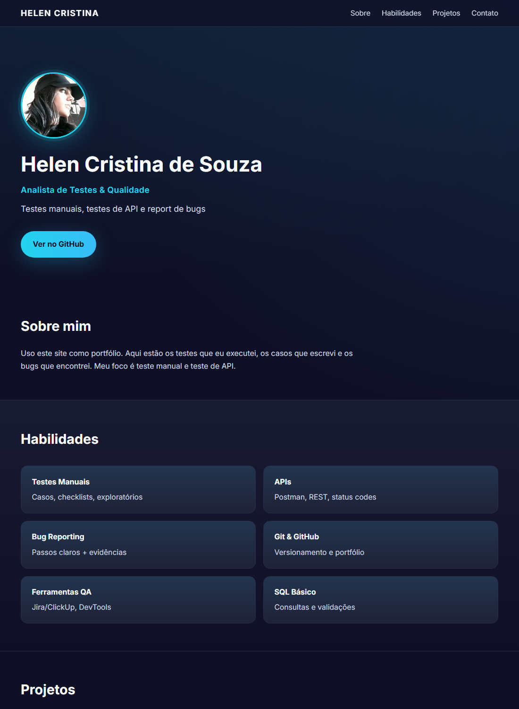



# Helen Cristina de Souza

### Analista de Testes e Qualidade (QA)

Testes manuais, testes de API e report de bugs

---

  
  
  
  
   
  
  
  
  
    
  

---

## Sobre mim

Sou Analista de Testes e Qualidade e uso este repositório como portfólio. Aqui ficam os testes que eu executei, os casos que escrevi, os bugs que encontrei e o resultado de cada execução.

Hoje meu foco é teste manual e teste de API. Gosto de entender o fluxo do produto, cobrir o caminho principal e também os cenários que costumam quebrar, como campo vazio, dado inválido e retorno de erro. Automação fica pra depois, mas quero chegar lá.

## Habilidades

- **Testes manuais:** casos de teste, checklist e teste exploratório
- **Testes de API:** Postman, validação de status code, cabeçalho e corpo da resposta
- **Report de bug:** passos para reproduzir, resultado esperado x obtido e evidência
- **Ferramentas:** Postman, Git/GitHub, Chrome DevTools, Jira/ClickUp
- **Banco de dados:** consultas SQL básicas
- **Tipos de teste:** funcional, regressão, smoke e exploratório

## Projetos

| Projeto | O que testei | Ferramentas | Status |
|---|---|---|---|
| [API ReqRes](./projetos/01-teste-api-reqres/README.md) | CRUD de usuários numa API REST pública | Postman, Markdown | Finalizado (7 de 7 passaram) |
| [Checkout de e-commerce](./projetos/02-teste-ecommerce-ficticio/README.md) | Login, carrinho e finalização de compra | Checklist, Markdown | Finalizado |
| [Formulário web](./projetos/03-teste-formulario/README.md) | Validação de campos e mensagens de erro | Checklist, Markdown | Finalizado |

## Evidências

Resultado da execução dos testes de API:

Como o site ficou:

## O que tem dentro de cada projeto

- **README.md** - o que o projeto testa e qual foi o resultado
- **casos-de-teste.md** - os casos com passos e critério de aceite
- **checklist.md** - versão curta pra rodar rápido
- **bugs-report.md** - os bugs encontrados (quando tem)
- **postman-collection.json** - a coleção pra importar no Postman
- **evidencias/** - prints, relatórios e resultados

## Contato

- GitHub: [github.com/Cahostremere](https://github.com/Cahostremere)
- LinkedIn: [linkedin.com/in/helen-cristina-de-souza](https://www.linkedin.com/in/helen-cristina-de-souza)
- Email: helencristinadsouza@gmail.com

## O que estou estudando

- Testes de API com mais profundidade (autenticação e validação de contrato)
- Automação básica com Playwright e Cypress
- SQL para conferir dados direto no banco
