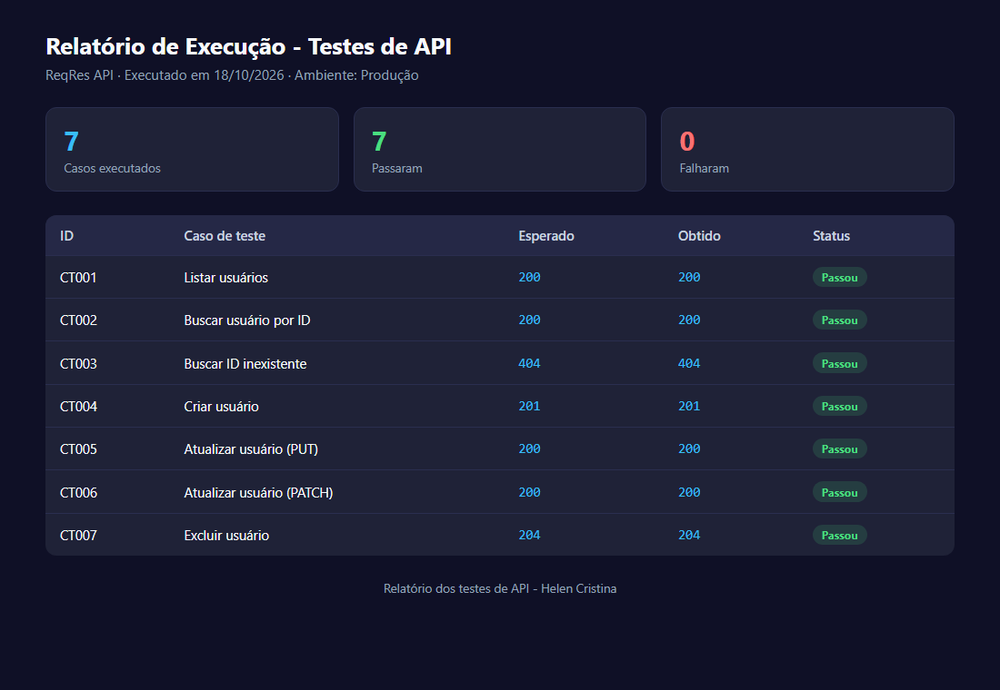

# Projeto 01 - Testes de API na ReqRes

Esse foi o primeiro projeto que montei pra treinar teste de API. Escolhi a [ReqRes](https://reqres.in/) porque é pública e não precisa de cadastro.

## O que eu testei

Peguei os endpoints de usuários e cobri o básico de um CRUD:

- listar usuários
- buscar um usuário pelo ID
- criar usuário
- atualizar (testei com PUT e com PATCH)
- excluir usuário

Também testei pedir um usuário que não existe, pra ver se a API devolve erro direito.

## Ferramentas

- Postman, pra montar e rodar as requisições
- A própria API ReqRes

## Como rodar

1. Importa o `postman-collection.json` no Postman
2. Roda as requisições na ordem dos casos de teste
3. Compara o retorno com o que tá em `casos-de-teste.md`

## O que tem aqui

- `casos-de-teste.md` - os casos com passos e o esperado
- `checklist.md` - versão curta pra rodar rápido
- `bugs-report.md` - o que eu anotei de estranho
- `postman-collection.json` - a coleção pra importar
- `evidencias/` - relatório e print da execução

## Resultado

Rodei os 7 casos e todos passaram. O relatório com os retornos reais está em `evidencias/`.

