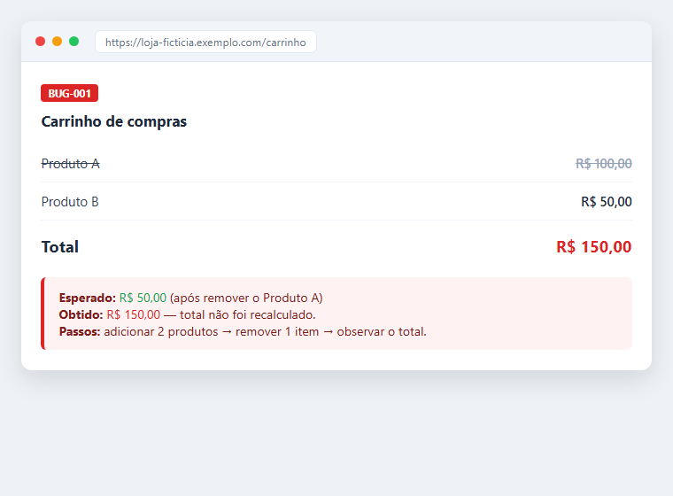

# Projeto 02 - Testes num e-commerce fictício

Esse foi um exercício de teste manual. Imaginei uma loja e escrevi os casos cobrindo os fluxos que mais costumam dar problema numa compra.

## O que eu cobri

- login e logout
- listagem e busca de produto
- adicionar e remover item do carrinho
- cálculo dos valores
- finalização da compra
- validação dos campos

## Por que esses fluxos

Foquei no que, se quebrar, atrapalha a venda: a entrada do usuário, o carrinho e o pagamento.

## O que tem aqui

- `casos-de-teste.md` - os casos com passos e o esperado
- `checklist.md` - versão curta pra rodar rápido
- `bugs-report.md` - os bugs que anotei
- `evidencias/` - uma imagem mostrando o bug do carrinho

## Resultado

Escrevi 10 casos e achei um problema no carrinho: o total não recalcula quando você remove um item. Deixei uma imagem ilustrando a falha.

