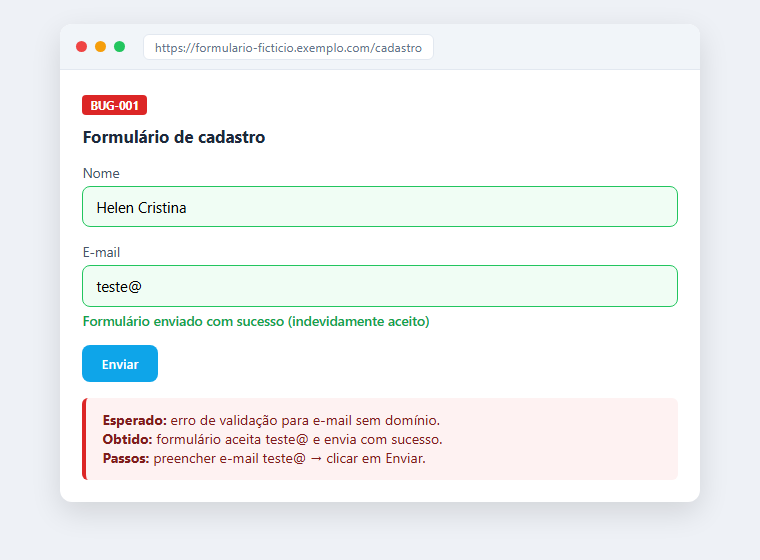

# Projeto 03 - Testes num formulário web

Aqui eu testei um formulário de cadastro, olhando principalmente a validação dos campos e as mensagens de erro.

## O que eu olhei

- campos obrigatórios
- validação de e-mail
- formato e máscara dos campos
- limite de caracteres
- o que acontece quando envia

## Como eu testei

Comecei pelos casos normais, do caminho feliz, e depois fui tentando coisa estranha: e-mail sem domínio, texto com caractere especial, clique duplo no botão de enviar.

## O que tem aqui

- `casos-de-teste.md` - os casos com passos e o esperado
- `checklist.md` - versão curta pra rodar rápido
- `bugs-report.md` - os bugs que anotei
- `evidencias/` - uma imagem mostrando o bug do e-mail

## Resultado

Achei um problema na validação do e-mail: o formulário aceita um endereço sem domínio. Deixei uma imagem ilustrando.

